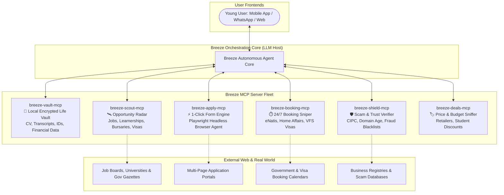

# Breeze 🌬️
### The Universal Life & Opportunity Co-Pilot for Youth
*One Click. Zero Friction. Nothing passes you unnoticed.*

[](https://opensource.org/licenses/Apache-2.0)
[](https://modelcontextprotocol.io/)
[]()

---

## 🧭 The Manifesto: Why Breeze Exists

The modern internet promises opportunity, but delivers **exhaustion and fragmentation**:

* **Repetitive Form Fatigue:** To apply for 10 jobs, 3 universities, and 2 bursaries, a young person has to create 15 accounts and manually type their name, ID number, matric results, and address **over 40 times**.
* **Invisible Deadlines:** Vital life milestones (NSFAS applications, SETA learnerships, university admission windows, visa lottery intakes) open and close quietly without young people knowing.
* **Bureaucratic Hell:** Booking a driver's license test (eNatis), passport appointment (Home Affairs), or visa interview requires checking broken websites at 2:00 AM hoping for a cancellation.
* **Predatory Scams:** Unemployed youth are constantly hunted by fake WhatsApp recruiters, "pay-to-interview" schemes, and bogus visa consultants.

**Breeze kills this fragmentation.** It acts as your autonomous digital proxy. You store your life profile once in your local encrypted vault, and Breeze hunts opportunities, fills out complex multi-page applications with one tap, snipes bureaucratic booking slots, and blocks every scam in its tracks.

---

## 🏛️ System Architecture (Powered by Model Context Protocol)

Breeze is built natively on the **Model Context Protocol (MCP)**. Instead of brittle custom scrapers, Breeze coordinates modular, sandboxed MCP servers that expose specialized **Tools**, **Resources**, and **Prompts** to an orchestrating AI agent.



---

##  The 5 Pillars of Breeze

### 1.  The Opportunity Radar (`breeze-scout-mcp`)
* **Continuous Web Mining:** Scans thousands of fragmented sources across South Africa and global remote channels:
  * **Jobs & Remote Gigs:** LinkedIn, Indeed, Pnet, Careers24, Remotive, Upwork.
  * **Learnerships & TVETs:** SETA portals, YES4Youth, TVET college registrations.
  * **Higher Education:** University admissions (CAO, individual university portals).
  * **Bursaries & Grants:** NSFAS, Funza Lushaka, corporate bursary funds, NYDA youth grants.
  * **Visas & Exchange:** Youth travel visas, working holiday schemes, scholarship intakes (Chevening, Erasmus, Mandela Rhodes).
* **Zero-Miss Alerts:** Never miss a cutoff date. Breeze notifies you 7 days, 3 days, and 24 hours before admissions close.

### 2.  Universal 1-Click Apply (`breeze-apply-mcp`)
* **Fill It Once, Apply Everywhere:** Store your personal details, academic history, resume, ID document, and motivational statements inside `breeze-vault-mcp`.
* **Autonomous Form Navigation:** When you click *"Apply"*, the agent spins up a headless browser, navigates the application portal, maps your vault data to the input fields, uploads your certified PDFs, and brings you a 100% completed form for your final one-tap review and sign-off.

### 3. ⏱ Bureaucracy & Booking Sniper (`breeze-booking-mcp`)
* **24/7 Automated Slot Watcher:** Booking driving license test slots (eNatis), passport appointments (Home Affairs), clinic slots, or visa appointments (VFS Global) usually requires refreshing pages for days.
* **Instant Snipe:** Breeze monitors booking calendars 24/7. When a cancellation or new batch of slots opens, Breeze reserves the spot instantly and pings you on WhatsApp to confirm.

### 4.  The Scam & Exploitation Shield (`breeze-shield-mcp`)
* **Real-Time Due Diligence:** Protects vulnerable young people from employment fraud.
* **Automated Vetting:**
  * Cross-references company registration numbers (CIPC in South Africa, SEC, Companies House).
  * Analyzes domain creation date (flags domains registered < 90 days ago posing as big banks).
  * Scans job descriptions for advance-fee triggers (*"Pay R250 for uniform/medical check before interview"*).
  * Provides an instant Trust Score (Green / Yellow / Red).

### 5.  Student Budget & Deal Hunter (`breeze-deals-mcp`)
* **Transparent Internet Pricing:** Tracks prices on student tech gear (laptops, headphones, textbooks), groceries, and transport.
* **Fake Discount Detection:** Exposes inflated "discounts" by checking 90-day price history graphs and automatically applies active promo codes.

---

##  Repository Structure

```
Breeze/
├── README.md                          # Executive Manifesto & Architecture
├── LICENSE                            # Apache 2.0 Open Source License
├── docs/                              # Comprehensive Specifications
│   ├── 01_Product_Vision_Scope.md     # Feature Scope & User Personas
│   ├── 02_MCP_Architecture.md         # Model Context Protocol Design Spec
│   ├── 03_Universal_1Click_Apply.md   # Headless Form-Filling Engine Spec
│   ├── 04_Opportunity_Radar.md        # Jobs, Bursaries & Learnerships Engine
│   ├── 05_Automated_Bookings.md       # Government & Public Booking Sniper Spec
│   └── 06_Scam_Shield_Trust_Engine.md # Anti-Fraud & CIPC Verification Engine
└── packages/                          # Modular MCP Server Implementations
    ├── breeze-vault-mcp/              # User Profile Vault (Local Encrypted SQLite)
    ├── breeze-scout-mcp/              # Opportunity Mining & Radar Server
    ├── breeze-shield-mcp/             # Scam Detection & Verifier Server
    └── breeze-booking-mcp/            # Automated Booking & Calendar Watcher
```

---

##  Technology Stack

| Layer | Technologies |
| :--- | :--- |
| **Agent & Protocol** | Model Context Protocol (Anthropic MCP SDK), Python / TypeScript |
| **Automation & Form-Filling** | Playwright, Puppeteer, Chromium Headless, Stealth Plugin |
| **AI & NLP** | Claude 3.5 Sonnet / Gemini 1.5 Flash (via MCP Client), OpenAI Whisper |
| **Local Encrypted Vault** | SQLite with SQLCipher (AES-256), Pydantic v2 data models |
| **Opportunity Mining** | Crawlee, BeautifulSoup4, Feedparser, Serper / Brave Search API |
| **Channels & Notification** | WhatsApp Cloud API (Twilio), Telegram Bot API, Web PWA |

---

##  Quick Start & Development

To test the Breeze MCP servers locally with your AI agent:

```bash
# Clone the repository
git clone git@github.com:BhekumusaEric/Breeze.git
cd Breeze

# Install dependencies
pip install -r requirements.txt

# Run the Vault MCP Server
python packages/breeze-vault-mcp/server.py

# Run the Shield Scam Verification Server
python packages/breeze-shield-mcp/server.py
```

---

## 🤝 Open Source & Contributing

Breeze is proudly open-source under the **Apache 2.0 License**. We believe that every young person deserves an equal shot at education, employment, and dignity without being exploited by a broken, fragmented internet.

*Created with ❤️ by Bhekumusa Eric Ntshwenya*
