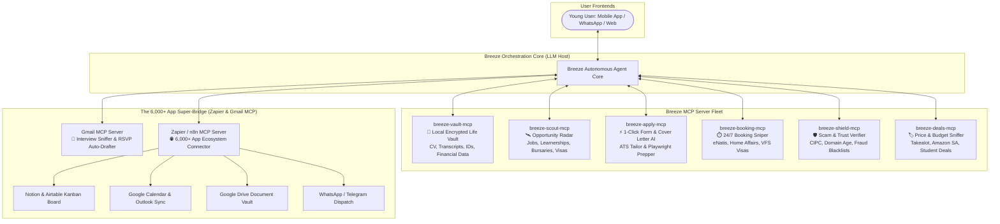

# Breeze 🌬️
### The Universal Life & Opportunity Co-Pilot for Youth
*One Click. Zero Friction. Nothing passes you unnoticed.*

[](https://opensource.org/licenses/Apache-2.0)
[](https://modelcontextprotocol.io/)
[]()
[]()

---

## 🧭 The Manifesto: Why Breeze Exists

The modern internet promises opportunity, but delivers **exhaustion and fragmentation**:

* **Repetitive Form Fatigue:** To apply for 10 jobs, 3 universities, and 2 bursaries, a young person has to create 15 accounts and manually type their name, ID number, matric results, and address **over 40 times**.
* **Buried Interview Invites:** Important interview emails get buried in Gmail's "Promotions" tab or spam, costing youth life-changing opportunities.
* **Invisible Deadlines:** Vital life milestones (NSFAS applications, SETA learnerships, university admission windows, visa lottery intakes) open and close quietly without young people knowing.
* **Bureaucratic Hell:** Booking a driver's license test (eNatis), passport appointment (Home Affairs), or visa interview requires checking broken websites at 2:00 AM hoping for a cancellation.
* **Predatory Scams:** Unemployed youth are constantly hunted by fake WhatsApp recruiters, "pay-to-interview" schemes, and bogus visa consultants.

**Breeze kills this fragmentation.** It acts as your autonomous digital proxy. You store your life profile once in your local encrypted vault, and Breeze hunts opportunities, drafts tailored ATS cover letters, fills out complex forms with one tap, monitors Gmail for interview invites, syncs to Google Calendar, and blocks scams in their tracks.

---

## 🏛️ System Architecture (Powered by Model Context Protocol)

Breeze is built natively on the **Model Context Protocol (MCP)**. Instead of brittle custom scrapers, Breeze coordinates modular, sandboxed MCP servers that expose specialized **Tools**, **Resources**, and **Prompts** to an orchestrating AI agent.



---

## 🌟 The Core Pillars of Breeze

### 1. 📧 Gmail Intelligence & Interview RSVP (`breeze_parse_email_intelligence`)
* **Auto-Interview Detection:** Scans incoming recruiter emails, extracts interview dates/times and Microsoft Teams / Google Meet links.
* **1-Tap Calendar & RSVP:** Prepares a Google Calendar event with a 2-hour reminder and drafts a polite, tailored confirmation reply.
* **Confirmation Logging:** Automatically extracts application reference numbers (e.g. `#SB-9021`) and logs them into your tracker.

### 2. 🌐 The 6,000+ App Ecosystem Bridge (`breeze_format_notion_tracker_entry`)
* **Instant Notion / Airtable Tracking:** Connected through Zapier/n8n MCP to update your personal Opportunity Kanban board without manual spreadsheet entry.
* **Google Calendar Sync:** Automatically tracks bursary deadlines, test dates, and interviews on your mobile calendar.

### 3. ✍️ AI CV & Cover Letter Tailor (`breeze_tailor_application`)
* **Kills Application Fatigue:** Analyzes any job description against your Vault skills, calculates an ATS match score, and generates a compelling, professional cover letter in 1 second.

### 4. ⚡ Universal 1-Click Form Prepper (`breeze_prepare_form_payload`)
* **Fill It Once, Apply Everywhere:** Automatically generates the 18+ field mapping dictionary for any university, bursary, or job portal, attaching verified PDF certificates with zero manual typing.

### 5. 🛰️ The Opportunity Radar (`breeze_live_hunt_opportunities` / `breeze_search_opportunities`)
* **Live Web & SETA Mining:** Searches LinkedIn, Careers24, SETA learnerships, and government circulars in real time with deadline warnings.

### 6. 🛡️ The Scam & Exploitation Shield (`breeze_inspect_scam`)
* **Real-Time Due Diligence:** Scans job ads and WhatsApp messages for advance-fee traps (*"Pay R250 for uniform/medical check"*), fake webmail impersonation, and unverified companies.

### 7. 🏷️ Student Budget & Deal Hunter (`breeze_compare_prices`)
* **Transparent Internet Pricing:** Live price comparison across Takealot, Amazon SA, and Makro, analyzing 90-day price history to expose fake discounts on laptops and student essentials.

### 8. ⏱️ Bureaucracy & Booking Sniper (`breeze_check_appointments`)
* **24/7 Automated Slot Watcher:** Continuously checks for open driver's license (eNatis), passport (Home Affairs), and visa appointment cancellations.

---

## 📦 Repository Structure

```
Breeze/
├── README.md                                  # Executive Manifesto & Architecture
├── LICENSE                                    # Apache 2.0 Open Source License
├── requirements.txt                           # Core Python Dependencies
├── docs/                                      # In-Depth Technical Specifications
│   ├── 01_Product_Vision_Scope.md             # Youth Life Starter Pack & User Personas
│   ├── 02_MCP_Architecture.md                 # MCP Host/Client/Server Protocol Design
│   ├── 03_Universal_1Click_Apply.md           # Headless DOM Mapping & Playwright Engine
│   ├── 04_Opportunity_Radar.md                # Jobs, SETA Learnerships & Bursary Mining
│   ├── 05_Automated_Bookings.md               # 24/7 eNatis, Passport & Visa Booking Sniper
│   ├── 06_Scam_Shield_Trust_Engine.md         # Anti-Fraud & CIPC Corporate Registry Verifier
│   └── 07_Gmail_and_Ecosystem_Integrations.md # Gmail, Zapier & 6,000+ App Automation Guide
└── packages/
    └── breeze_mcp_server.py                   # Unified Enterprise MCP Server (11 Tools)
```

---

## 🛠️ Technology Stack

| Layer | Technologies |
| :--- | :--- |
| **Agent & Protocol** | Model Context Protocol (Anthropic MCP SDK), Python 3.10+, JSON-RPC 2.0 |
| **Integrations (6,000+ Apps)** | Zapier MCP Server, Gmail MCP, Google Calendar, Notion, WhatsApp Cloud API |
| **Automation & Form-Filling** | Playwright, Puppeteer, Chromium Headless |
| **Local Encrypted Vault** | SQLite with SQLCipher (AES-256), Pydantic v2 |
| **Opportunity Mining** | DuckDuckGo HTTP Scraping, Crawlee, BeautifulSoup4 |

---

## 🚀 Quick Start & Live Testing

```bash
# Clone the repository
git clone git@github.com:BhekumusaEric/Breeze.git
cd Breeze

# Run the unified Enterprise Breeze MCP Server
python packages/breeze_mcp_server.py
```

---

*Created with ❤️ by Bhekumusa Eric Ntshwenya | The Autonomous Life Co-Pilot for Youth*
