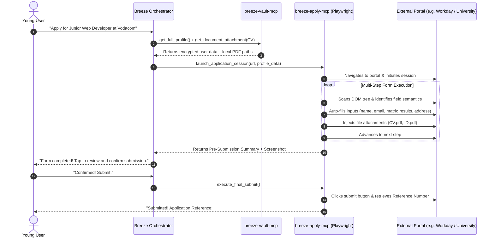

# 03: Universal 1-Click Apply Engine Specification

## 1. Problem Statement
Filling out web forms is the most tedious, repetitive barrier standing between youth and opportunity. A typical university admission or job application portal features:
* 4 to 8 sequential wizard steps.
* 40 to 90 distinct input fields (text, dropdowns, radio buttons, dates).
* Strict file upload validations (PDF format, size limits < 2MB).
* Inconsistent field naming conventions (`fname`, `txtFirstName`, `applicant_first_name`).

---

## 2. Technical Execution Flow

---

## 3. Intelligent Field Semantic Mapping

`breeze-apply-mcp` utilizes an LLM-assisted heuristic mapping model to match unpredictable HTML input fields to verified user data fields:

| Field Classification | Sample HTML Attributes | Mapped Vault Entity |
| :--- | :--- | :--- |
| **First Name** | `name="given-name"`, `id="txtFirstName"`, `placeholder="First Name"` | `profile.personal.first_name` |
| **National ID / Passport** | `name="id_number"`, `id="nationalId"`, `name="txtSAID"` | `profile.identity.id_number` |
| **Matric English Mark** | `name="eng_hl_level"`, `id="sub_english_score"` | `profile.academics.matric.subjects["English"]` |
| **Residential Address** | `name="address1"`, `id="street_address"`, `autocomplete="street-address"` | `profile.contact.street_address` |
| **Postal Code** | `name="zip"`, `id="postalCode"`, `maxlength="4"` | `profile.contact.postal_code` |
| **Disability Status** | `name="has_disability"`, `id="disability_radio_no"` | `profile.demographics.disability_status` |

---

## 4. Human-in-the-Loop Safeguard
To maintain complete user trust and avoid unintended submissions, Breeze adheres strictly to the **Human-in-the-Loop Rule**:
1. The AI performs 100% of the manual labor (typing, selecting dropdowns, attaching files).
2. The AI **never** clicks the final *"Confirm & Submit"* button autonomously.
3. It displays an interactive visual card showing the filled fields and a captured screenshot of the final page, requiring a single tap from the user to finalize the submission.

