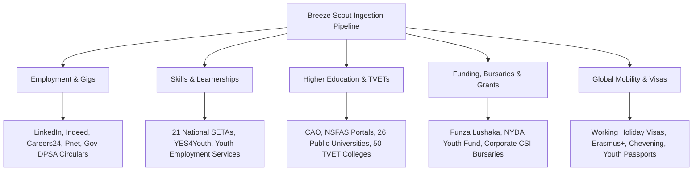

# 04: Opportunity Radar Specification (`breeze-scout-mcp`)

## 1. Objective
Eliminate information asymmetry for young people by continuously crawling, filtering, and indexing opportunities across education, employment, funding, and international mobility.

---

## 2. Ingestion Channels & Sources

---

## 3. The Match-Score & Relevance Engine

When opportunities are crawled, they are ranked against the user's `breeze-vault-mcp` profile using a multi-factor weighting algorithm:

$$\text{MatchScore} = (w_1 \cdot \text{SkillOverlap}) + (w_2 \cdot \text{EducationTier}) + (w_3 \cdot \text{LocationProximity}) + (w_4 \cdot \text{ExperienceFit})$$

### Scoring Criteria:
* **Academic Eligibility:** Rejects listings where the applicant does not meet minimum matric/diploma thresholds (e.g. Maths Pure requirement vs Maths Literacy).
* **Location Feasibility:** Prioritizes opportunities within reasonable commuting radius or fully remote listings.
* **Ghost Job Filter:** Discards listings that have been continuously reposted for $>90$ days without active hiring.

---

## 4. Proactive Deadline Radar
Breeze does not wait for the user to search. It sends automated proactive alerts:
* **T-minus 7 Days:** *"University of Pretoria 2027 Engineering applications close in 7 days. Your profile is 96% complete. Tap to finalize."*
* **T-minus 48 Hours:** *"Urgent: SASSETA Learnership intake closes Friday 16:00. 15 spots remaining in Gauteng."*
