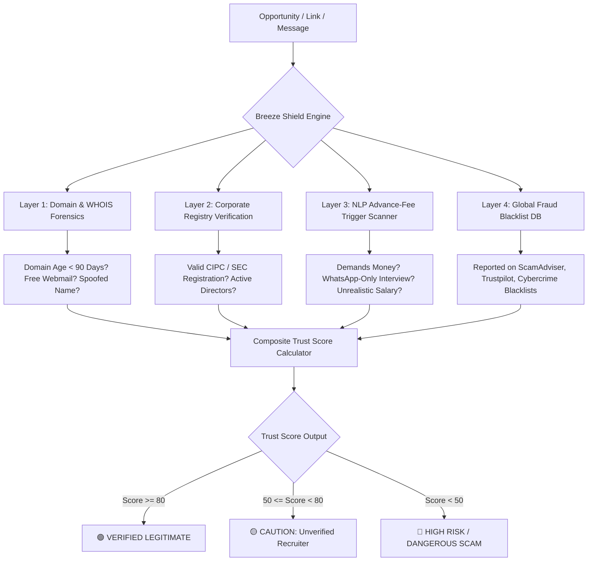

# 06: Scam Shield & Trust Engine (`breeze-shield-mcp`)

## 1. Problem Statement
Job scams, fake bursaries, and immigration fraud disproportionately victimize young, desperate job seekers:
* **Advance-Fee Fraud:** Requiring "registration fees", "medical test fees", or "uniform deposits" prior to an interview.
* **Fake Company Impersonation:** Scammers setting up spoof domains (e.g. `careers-standardbank-sa.com`) with stolen logos.
* **Pyramid & Ponzi Schemes:** Disguising recruit-your-friends schemes as "marketing internships".

---

## 2. Multi-Layer Verification Pipeline

---

## 3. High-Confidence Red Flag Signatures

`breeze-shield-mcp` automatically flags and rejects opportunities matching these patterns:

1. **Email Domain Mismatch:** The posting claims to be from a listed corporation (e.g., Sasol, Woolworths, Anglo American), but official contact is routed to `@gmail.com`, `@yahoo.com`, or `@outlook.com`.
2. **Fee Demand Trigger Words:** Detects phrases like *"bring R350 for gate pass"*, *"uniform fee deductible"*, *"medical screening fee"*, or *"payment before interview"*.
3. **Suspicious Interview Locations:** Identifies residential addresses, empty industrial parks, or fast-food restaurants listed as interview venues for corporate positions.
4. **Instant WhatsApp Hiring:** Immediate job offers extended without any application review or credential verification.

