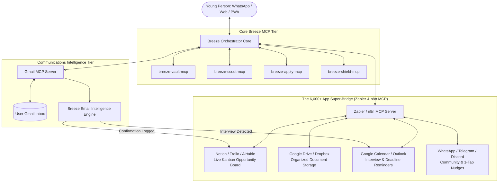

# 07: Gmail & 6,000+ App Ecosystem Integration
## The Autonomous Life Operating System for Youth

---

## 1. Executive Summary
Young people lose life-changing opportunities not because they lack talent, but because administrative friction burns them out. An application is only the first step in a chaotic chain:
* Interview invitations get buried in Gmail's "Promotions" tab or spam.
* Young people forget when or where they applied, losing track of reference numbers.
* Important interview dates are forgotten without automated calendar sync.
* Certified documents are scattered across WhatsApp chats, downloads folders, and broken flash drives.

By integrating **Gmail MCP** and the **Zapier / n8n MCP Super-Bridge (6,000+ apps)**, Breeze closes the loop: **from discovery and application to email monitoring, calendar booking, and portfolio tracking.**

---

## 2. The Ecosystem Topology



---

## 3. High-Value Automated Workflows

### Workflow 1: The "Interview Sniffer" & 1-Tap RSVP
1. **Detection:** Gmail MCP continuously checks for incoming emails with keywords like *"Interview"*, *"Assessment"*, *"Shortlisted"*, *"Microsoft Teams"*, or *"Google Meet"*.
2. **Extraction:** Breeze parses:
   * Company name and interviewer identity.
   * Proposed date, time, and timezone.
   * Video conferencing link or physical office address.
3. **Action:**
   * Breeze auto-slots the event into **Google Calendar** with a 2-hour prep reminder.
   * Generates a tailored, professional RSVP acceptance email:
     ```
     Subject: Re: Interview Invitation - Junior Systems Technician - Bhekumusa Ntshwenya
     
     Dear Ms. Mokoena,
     
     Thank you for shortlisting my application. I am pleased to confirm my attendance 
     for the virtual technical interview on Thursday, 28 November 2026 at 10:00 AM (SAST) 
     via Microsoft Teams.
     
     I look forward to discussing how my technical background aligns with your team's goals.
     
     Kind regards,
     Bhekumusa Ntshwenya
     ```
   * Pings user's WhatsApp: *"Interview invite received from Dimension Data for Thursday 10:00 AM. I have drafted the acceptance. Tap to send."*

---

### Workflow 2: Automated Notion / Google Sheets Kanban Board
Every time Breeze applies for a job, learnership, or bursary, it communicates through **Zapier MCP** to create a structured database card:

| Column | Example Value | Automation Trigger |
| :--- | :--- | :--- |
| **Organization** | Standard Bank Group | Auto-filled upon 1-click apply |
| **Role** | 2027 IT Graduate Trainee | Auto-filled upon 1-click apply |
| **Status** | `Applied` $\rightarrow$ `Interviewing` $\rightarrow$ `Offer` | Auto-updated by Gmail MCP |
| **Reference #** | `#SB-2026-9912` | Extracted from confirmation email |
| **Date Applied** | 08 November 2026 | Timestamped automatically |
| **Next Action Date** | 22 November 2026 (Follow-up) | 14-day reminder scheduled |

---

### Workflow 3: Cloud Document Vault Sync (Google Drive)
* Young people often lose certified copies when their phone breaks or memory fills up.
* Breeze connects via **Google Drive MCP** to maintain a persistent, certified document binder:
  * `/Breeze/Documents/Certified_ID_2026.pdf`
  * `/Breeze/Documents/Matric_Certificate_NSC.pdf`
  * `/Breeze/Documents/Tertiary_Academic_Record.pdf`
  * `/Breeze/Applications/2026_Standard_Bank_Cover_Letter.pdf`

---

## 4. Configuration Guide (`mcp_config.json`)

To enable these integrations, add the respective MCP servers to your Antigravity / Claude config:

```json
{
  "mcpServers": {
    "breeze": {
      "command": "python",
      "args": ["C:\\Users\\ressah-lab\\Breeze\\packages\\breeze_mcp_server.py"]
    },
    "gmail": {
      "command": "npx",
      "args": ["-y", "@modelcontextprotocol/server-gmail"],
      "env": {
        "GMAIL_CLIENT_ID": "<your-google-client-id>",
        "GMAIL_CLIENT_SECRET": "<your-google-client-secret>"
      }
    },
    "zapier": {
      "command": "npx",
      "args": ["-y", "@zapier/mcp-server"],
      "env": {
        "ZAPIER_NLA_API_KEY": "<your-zapier-nla-key>"
      }
    }
  }
}
```

---

## 5. Privacy & Zero-Data-Selling Guarantee
* **Zero Tracking:** Breeze accesses Gmail strictly in read/draft mode for application-specific queries.
* **Local Parsing:** Email content is evaluated using local heuristics and verified LLM endpoints without training third-party public models.
* **User Control:** Breeze will **never** send an email or accept an interview without explicit, human-in-the-loop confirmation.
